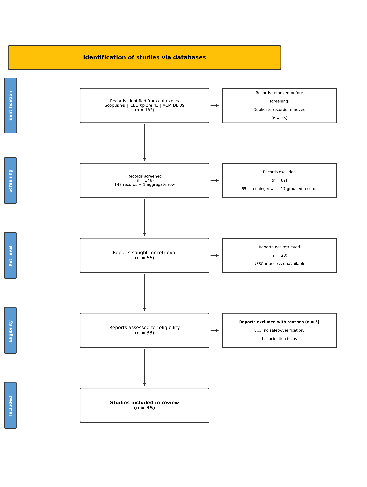
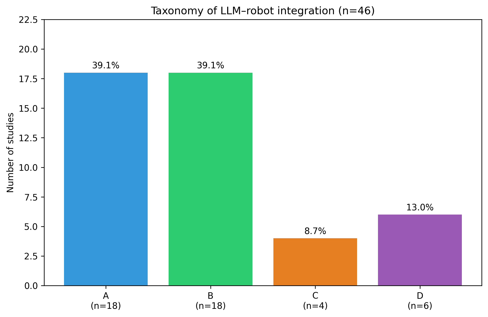
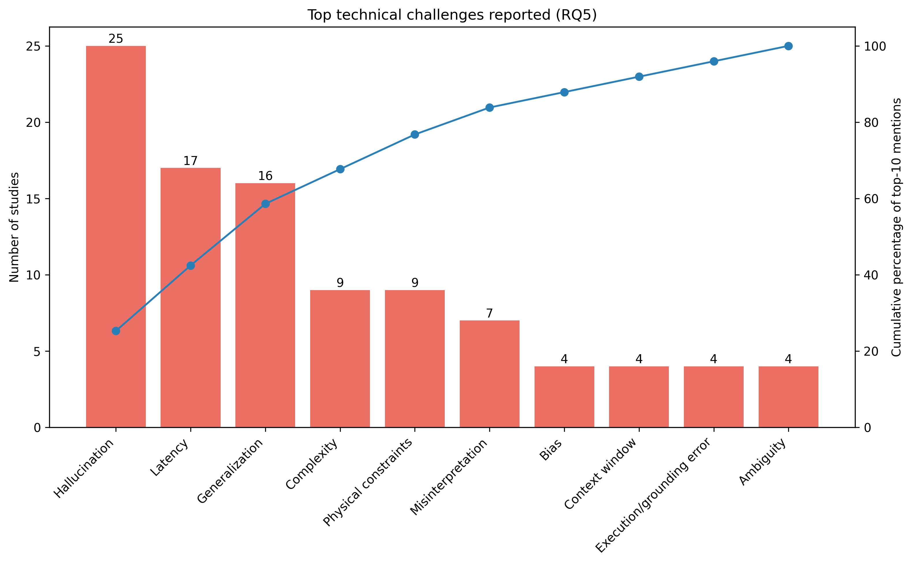

# LARS 2026 Systematic Review

Reproducibility repository for the LARS 2026 systematic review of large language models in mobile robotics.

## Versioned release

The manuscript cites the clean, public reproducibility snapshot [`v1.1`](https://github.com/Felipe-Guerche/lars-2026-systematic-review/releases/tag/v1.1). It contains the canonical screening and extraction data (46 included studies), the supplementary open-access retrieval coding, the manuscript supplement (`docs/SR_supplement.md`), regenerated tables and figures, validation scripts, and provenance documentation used for the review. See the [release notes](docs/release_notes_v1.1.md).

**Repository development and maintenance:** Felipe Delduque Guerche (`Felipe-Guerche`). The associated article has its own scientific author list; repository development credit is documented separately.

The package intentionally excludes publisher PDFs, local Zotero attachments, local file paths, and private working files. See the [release notes](docs/release_notes_v1.1.md) for the exact scope and validation record.

## Citation

For the repository and its reproducibility artifacts, cite the versioned snapshot:

```bibtex
@misc{guerche2026larsrepo,
  author  = {Guerche, Felipe Delduque},
  title   = {LARS 2026 systematic review reproducibility repository},
  year    = {2026},
  version = {1.1},
  url     = {https://github.com/Felipe-Guerche/lars-2026-systematic-review/releases/tag/v1.1}
}
```

The repository also provides machine-readable citation metadata in [`CITATION.cff`](CITATION.cff). Cite the associated scientific article separately for its findings.

## Quick navigation

- [Search archive and query strings](data/search/README.md)
- [Screening archive](data/screening/README.md)
- [Study-level extraction](data/extraction/README.md)
- [Data dictionary](docs/data_dictionary.md)
- [Protocol](docs/protocol.md)
- [Provenance and limitations](docs/provenance.md)
- [Release notes (v1.1)](docs/release_notes_v1.1.md)
- [Citation metadata](CITATION.cff)
- [Generated tables and figures](results/README.md)
- [Analysis scripts](scripts/README.md)
- [Data license](DATA_LICENSE.md)

## Repository map

```text
data/
  search/       Search strings, database yields, and sanitized imported metadata
  screening/    Screening records and full-text decisions
  extraction/   Canonical English extraction table for the 46 included studies
  studies.csv   Metadata and screening status for all 55 full-text records
results/
  tables/       Tables generated from the canonical extraction table
  figures/      Figures generated by the analysis script
scripts/        Validation and result-generation scripts
docs/           Protocol, data dictionary, taxonomy, and provenance notes
```

## Search snapshot

- **Final search/update date:** 3 November 2025
- **Publication coverage:** January 2020–3 November 2025; November is partial-year coverage
- **Databases:** Scopus, IEEE Xplore, and ACM Digital Library
- **Reported records before deduplication:** 183
- **Reported records after deduplication:** 148
- **Full texts assessed:** 55 (38 in the original review + 17 recovered in supplementary open-access retrieval, August 2026)
- **Included studies:** 46
- **Full-text exclusions:** 9
- **Not retrieved:** 11 (10 with no open-access version found + 1 bot-blocked)

## Canonical sources

- `data/studies.csv` is the bibliographic and screening source for the 55 full-text records.
- `data/extraction/study_extraction.csv` is the source for all study-level results and contains 46 rows.
- `data/search/database_yields.csv` is the source for database and query yields.
- `data/search/zotero_full_text.bib` is the sanitized Zotero-compatible export of the 38 original full-text records (the 17 records from the supplementary retrieval round are documented in `oa_retrieval_coding.csv`); it contains metadata and DOIs, not abstracts or attachments.
- `results/` contains generated outputs, not hand-edited values.

## Results at a glance

### Screening flow

<p align="center">
  
</p>

The 148 screening units comprise 147 bibliographic records plus the original grouped proceedings row. See the [provenance note](docs/provenance.md) for the 17 mapped proceedings records and the 11 reports not retrieved (after the supplementary open-access retrieval round).

### Taxonomy distribution

<p align="center">
  
</p>

### Most frequent reported challenges

<p align="center">
  
</p>

See [results/README.md](results/README.md) for the complete set of generated figures and tables.

## Reproduce the results

Requires Python 3.10+ with `pandas`, `matplotlib`, and `seaborn`:

```bash
python -m pip install -r requirements.txt
python scripts/validate_data.py
python scripts/doublecheck_taxonomy.py
python scripts/generate_results.py
python scripts/generate_taxonomy.py
python scripts/generate_prisma.py
```

The scripts use repository-relative paths and write only to `results/`. The validation scripts check the screening counts, full-text corpus, extraction totals, and taxonomy boundary cases before figure generation.

## Important provenance note

The source workspace contains 147 bibliographic entries and 131 explicit title/abstract rows. The reported 148 PRISMA screening units consist of those 147 records plus the original `AdjunctProceedings*` grouped proceedings row, which covers 17 administrative proceedings records listed in `data/screening/grouped_exclusions.csv`. The 11 not-retrieved candidates are listed in `data/screening/not_retrieved.csv`; `data/screening/oa_retrieval_coding.csv` documents the coding of the 18 reports recovered in the supplementary open-access retrieval round. Screening, full-text assessment, study-level extraction, taxonomy coding, and borderline adjudication were performed by the first author (single coder). No auditable independent second-reviewer decision series was retained; therefore, no inter-rater agreement statistic is reported. The repository does not redistribute publisher PDFs or local Zotero attachments.

## Licenses and data policy

Scripts use the MIT license in [`LICENSE`](LICENSE). Original documentation, screening decisions, and derived annotations use CC BY 4.0 in [`DATA_LICENSE.md`](DATA_LICENSE.md). Third-party bibliographic metadata and quoted evidence remain subject to their original rights. Publisher PDFs, copied abstracts, and local Zotero attachments are not redistributed.
